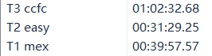
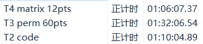

### 2026.10.24

[**A**  汇集](https://www.goj.wiki/d/Union2024/p/P2276?tid=6ada10f160ea062058dbde34)：感觉不太会做这类题目，需要在大量手玩情况下总结贪心策略和结论。upd：好像根本不难，猜到答案取到下界后就判是否有解，写一下限制要求就是 $\forall t\ge 0,\sum[a_i<t]\le t$，所以手动操作前 $n$ 次即可。

[**B**  余数](https://www.goj.wiki/d/Union2024/p/P2277?tid=6ada10f160ea062058dbde34)：缺乏对于关键性质的观察，未发现周期形成 $(012\dots (l-1))(0123\dots a_1)(0123\dots a_2)\dots$ 的性质，但其实样例解释有提示到。

[**C**  染色](https://www.goj.wiki/d/Union2024/p/P2278?tid=6ada10f160ea062058dbde34)：写出了 dp 转移但并未发现式子可以优化（真不能感觉状态空间爆了时间就会爆，可能有共用状态！）。优化完就是 $\mathcal O(nq\log n)$，想到分治就过了。

### 2026.10.27

[**C**  巡游(parade)](https://www.goj.wiki/d/Union2024/p/P2290?tid=6adf9c4960ea062058dffd49)：观察到了第一步，但是没有刻画对路径的选择，认为维护路径复杂度会过高。实际上可以转化到更加好的条件，有 $\forall x,y\in P$，$d_L(x,y)<d_R(x,k)+d_R(y,k)$，发现后可以用 dijkstra 维护。

[**D**  失忆(amnesia)](https://www.goj.wiki/d/Union2024/p/P2291?tid=6adf9c4960ea062058dffd49)：做过的原，但是思维链很长，赛时不好想到。主要因为没有将所选的数分成能被其他表示和不能的两种刻画出来。

### 2026.11.5

[**A**  数字串(mex)](https://www.goj.wiki/d/Union2024/p/P2321?tid=6aeb1a4c3e5ffd1425f67ccc)：做得有点久，写了拍还是挂了，小细节应该写完后再检查，造数据时尽量让分讨的每个条件都触发过。

[**B**  简单题(easy)](https://www.goj.wiki/d/Union2024/p/P2322?tid=6aeb1a4c3e5ffd1425f67ccc)：没啥问题，可能可以再快些。

[**C**  西西弗西(ccfc)](https://www.goj.wiki/d/Union2024/p/P2323?tid=6aeb1a4c3e5ffd1425f67ccc) ：几乎是做过的原题，没啥问题。

[**D**  二叉树(tree)](https://www.goj.wiki/d/Union2024/p/P2324?tid=6aeb1a4c3e5ffd1425f67ccc) ：暴力错了但是过了小样例，这种情况如果思考 5min+ 都不会应该要快速对拍保证正确性。

### 2026.11.6

[**A**  共鸣(resona)](https://www.goj.wiki/d/Union2024/p/P2250?tid=6aec4e133e5ffd1425f73027)：没啥问题。

[**B**  编码(code)](https://www.goj.wiki/d/Union2024/p/P2251?tid=6aec4e133e5ffd1425f73027) ：复杂度不太会分析，实际上分可以更少，不应该过了大样例就急着开下个题。

[**C**  排列游戏(perm)](https://www.goj.wiki/d/Union2024/p/P2252?tid=6aec4e133e5ffd1425f73027)：会了 60 但不会 80 就有点抽象。不应该将 $p_{q_i}$ 视作 $\to p_i\to p_{q_i}$，应该视作一个新的映射方法为 $a_i=p_{q_i}$。判每个点在哪个环应该考虑一个一个点加入后二分判断是否在一些环的并集中。

[**D**  矩阵(matrix)](https://www.goj.wiki/d/Union2024/p/P2253?tid=6aec4e133e5ffd1425f73027)：没啥问题，暴力写的有点慢影响了继续做 T3。

